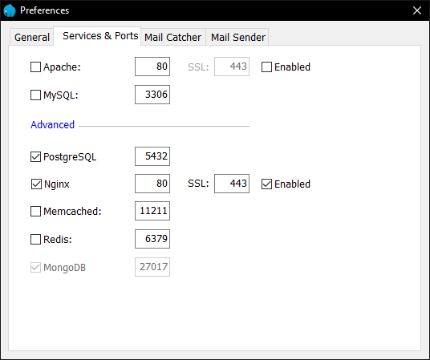
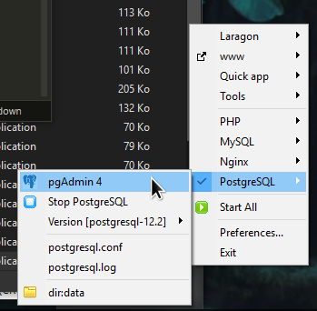
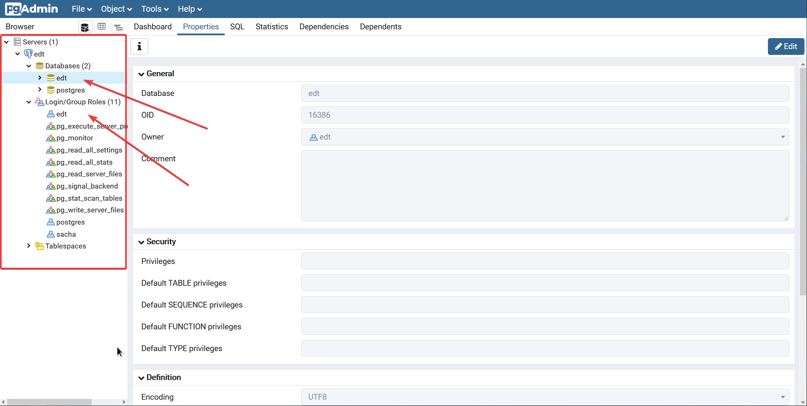

# Guide d'installation de l'environnement de dev.

## Installation Laragon
Afin d'avoir accès à un serveur web nginx préconfiguré et plein d'autres outils (Terminal, GUI client pour accéder aux BDs, nodejs, apache, **Nginx**, **PHP**, etc), On installe un logiciel qui s'appelle laragon.   

https://laragon.org/  
https://laragon.org/docs/

Il est facilement extensible, on peut lui ajouter le support pour plein d'autres langages et logiciels.

Une fois laragon installé, par défaut, il devrait se situer dans `C:/laragon`

```
.
├── ./bin
│	├── apache
│	├── cmder
│	├── composer
│	...
│	├── teln
│	├── wins
│	└── yarn
│	
├── data
├── etc
├── laragon.exe
├── tmp
├── usr
└── www
```

On peut ajouter dans `bin/${nom_du_logiciel}` différentes versions d'un même logiciel.

## **PHP** 7.3

On utilisera la version dernière version 7.3 de **PHP**. On peut la télécharger ici :  

https://windows.php.net/download/  
https://windows.php.net/downloads/releases/php-7.3.17-nts-Win32-VC15-x64.zip (7.3.17)

On va ensuite désarchiver l'archive obtenu dans le répertoire **PHP** afin d'obtenir :

```
./php
├── php-7.2.19-Win32-VC15-x64
│   ├── deplister.exe
│   ...
│   └── snapshot.txt
└── php-7.3.17-nts-Win32-VC15-x64
    ├── deplister.exe
    ...
    └── snapshot.txt
```

on ira extraire 

## PostgreSQL

Comme il ne vient pas par défaut avec **PostgreSQL** d'installé, on va l'ajouter manuellement.
On télécharge la dernière version de **PostgreSQL** à cette adresse :

https://www.enterprisedb.com/download-postgresql-binaries  
http://get.enterprisedb.com/postgresql/postgresql-12.2-2-windows-x64-binaries.zip (12.2-2)

On va ensuite créer un répertoire `./laragon/bin/postgresql` et désarchiver l'archive que nous avons téléchargé de **PostgreSQL** dans `./laragon/bin/postgresql/postgresql-${num_version}` (ici `postgresql-12.2`).

## Configuration laragon

On va dire à laragon d'utiliser **PostgreSQL** et **Nginx** (bien saisir les mêmes ports):



Et on choisit d'utiliser la version php que nous avons installé précédemment.


## Pour se connecter au serveur **PostgreSQL**

lancer **PostgreSQL** puis démarrer **pgAdmin4** :



en cliquant sur **pgAdmin4**, le navigateur s'ouvrira donnant accès au panneau d'administration des dbs PostgreSQL.  
On doit ensuite créer un utilisateur edt avec le mot de passe que l'on veut (ne pas l'oublier, le noter quelque part). Dans l'onglet **privilèges**, cocher 'can login'. ainsi qu'une base de donnée, portant le même nom, **edt** par exemple.


 
# Configuration de l'environnement de prod

guide pour Nginx/PHP 7.3 :

https://websiteforstudents.com/setup-nginx-web-servers-with-php-support-on-ubuntu-servers/


